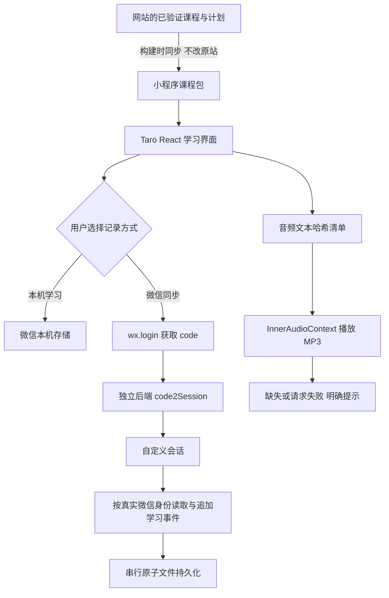
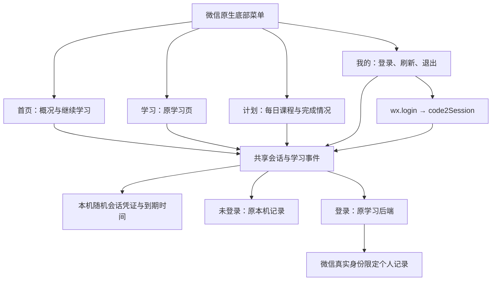
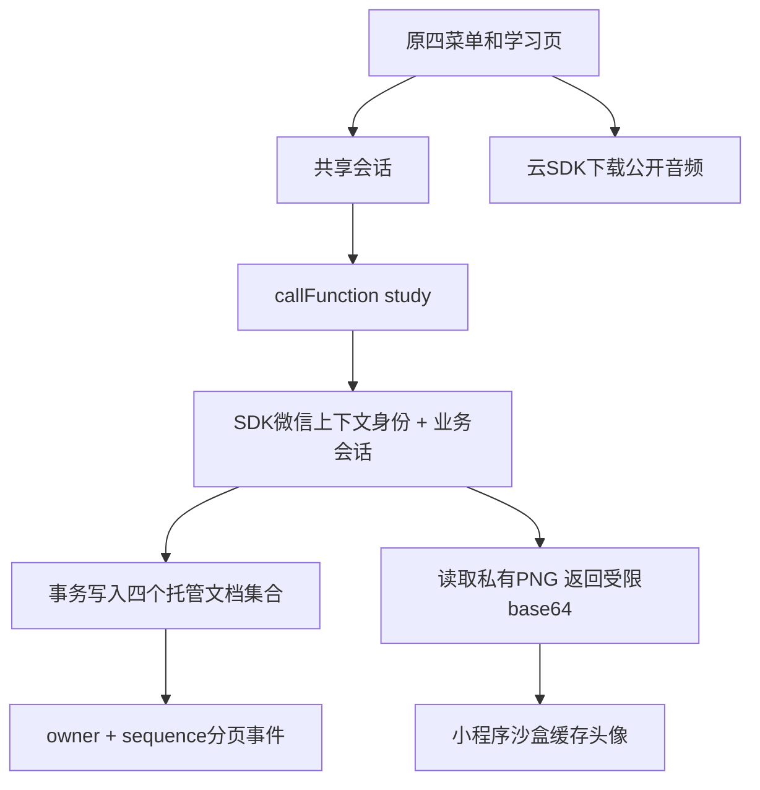

# 小程序结构

| 模块 | 职责 |
|---|---|
| src/pages/index | 小程序原生组件学习页面 |
| src/services/study | 记录模式、接口、读取与保存 |
| src/services/audio-option、audio | iPhone静音开关策略、音频地址解析及统一播放入口 |
| src/shared/daily-sentence | 从已发布课程生成每日内容池并按自然日期稳定选择 |
| src/shared/daily-*、lexical、oxford-wordlist | 原站同源课程类型、规划、词边界和校验 |
| src/shared/study-types、study-schema | 客户端和服务端共同事件合同及校验 |
| src/shared/progress | 已完成日期、最新测验和收藏状态 |
| src/content | 三日真实课程和MP3地址清单 |
| server/service | 微信换取身份、自定义会话、隔离事件、持久化 |
| server/index | HTTP边界、课程与音频读取、大小和频率限制 |
| scripts/sync-content | 从网站复制并记录SHA256来源 |
| scripts/audio-manifest | 精确英文文本生成版本化稳定路径 |
| scripts/generate-audio、verify-audio | 固定英式语音生成及真实MP3解码/长度/指纹验证 |
| audio/en-GB/v1、docs/audio-verification | 1128条新旧课程MP3及对应验证记录 |
| tests、server/server.test | 内容一致性、进度及服务安全验证 |

本机记录不会自动变成微信记录；微信服务失败时不切本机。答案由服务端重新评分。课程缺失、音频缺失和持久文件损坏直接报错。后端单进程保存数据，不共用或迁移网站数据库。

# 四菜单与共享会话（2026-10-21）

候选会话先读取课程和记录再整体切换；错误保持原账号。过期阻止保存，不切本机。明确退出时先清认证和账号事件，再载入本机记录并返回第1天。各页共享事件，避免重复保存或串账号；身份变更重建学习页，普通底部切页保留答题草稿。

## 账号资料
- src/services/profile.ts：上传选择的头像、保存昵称，带登录凭证下载私有头像。
- src/components/AccountSheet.tsx：复用微信登录和可选资料编辑弹窗；登录完成即返回原页面，不强制填写头像昵称。
- shared/profile-schema.ts、cloudfunctions/study/main/service.ts：服务端按账号内部标识生成稳定只读的公开用户ID，登录时补齐旧资料，不向客户端暴露OpenID。
- src/pages/plan/index.tsx：要求微信登录后创建或修改计划，逐日显示真实课程状态，并在首日课程可用时直接进入学习。
- src/pages/index/index.tsx：未登录首次进入显示三天试学开屏，只开放三天真实课程；登录后按微信账号计划加载课程。
- src/shared/profile-types.ts / profile-schema.ts：资料结构及输入校验。
- server/profile-service.ts：按账号保存独立profiles.json及私有头像，使用sharp解码校验和规范化，不更改学习记录文件。
- session-controller.ts：资料与进度整体加载后切换账号，退出时清空资料。

## 自选每日词数计划
- shared/personal-plan.ts：10～80整数校验、personal-v1计划合同、准确分天和日期计算，复用稳定的真实词表次序。
- services/personal-plan.ts：本机独立存储或微信认证计划接口，不写原学习记录。
- server/personal-plan-service.ts：独立plans.json、逐账号隔离、首次创建及幂等冲突校验，原子串行保存。
- session-controller.ts：计划与资料进度整体恢复和切换，创建失败不伪报成功，同词数重试复用编号。
- pages/plan：选择词数→预览→开始保存→分天展示；首页、我的读取共享计划。
- 个人计划和原课程分开：新计划不复用原课程完成标记，生成短文测验仍待AI服务，不虚构内容。

2026-10-22按用户要求撤回个人日历接管学习页：学习继续由原LearningContent负责原课程/日历/进度，计划日期编辑独立保存，不改变学习页逻辑。

## 原学习页的日期范围同步
- shared/learning-calendar.ts：根据计划开始日期与北京时间今天生成calendarDays，真实课程列表days保持不变。
- session-controller.ts：selectDay可选择日历内未发布日期，record仍仅接受真实课程；持久化calendarPlanKey明确识别计划变化并重置第1天，重启保持有效选择。refreshCalendar无I/O，供隔天返回更新。
- pages/index：保留LearningContent阅读、测验、收藏和历史；原日历与日期选择使用calendarDays，缺课时日历仍显示。无替代学习页。

## 真实课程状态
- DaySummary.targetWords：本机与服务端公开课程目录返回完整目标词，不增加个人信息。
- shared/plan-course-status.ts：只统计计划已到天数，按课程编号与完整有序词表精确匹配可用课程；目录缺字段明确报错。
- pages/plan：渲染真实已准备/待制作数量，可用日期跳转原学习页；pages/home移除过时的统一未生成文案。学习页面未改。

## 2026-10-23检查修复
- content/catalog.json、shared/course-catalog.ts：前后端与检查工具统一课程目录。第3天为独立原创内容。
- 会话退出先撤销服务端凭证；网络失败保留原会话，撤销成功但本机写入失败则禁用已撤销凭证。
- 记录重试按操作复用编号，同一记录位置成功后清理旧失败操作，避免重复记录及误用旧编号。
- reviewingCourse明确区分原课程复习与当前计划；计划课程必须逐词精确匹配，计划变化退出复习状态。
- 音频服务检查实际文件路径边界；损坏持久文件返回500且不泄露校验细节。

## 全词库随机版本（2026-10-23）
- shared/daily-plan.ts：all-words-shuffle-v2固定种子Fisher–Yates洗牌，全部词参与，不保留旧第1天；personal-plan复用同一顺序按词数切片。
- shared/learning-calendar.ts：日历标识包含随机计划版本，更新词序后返回第1天，不修改个人计划文件。
- content/day1～3：按新随机词表重写；新情境编号301～306防止旧测验答案套入新课。
- shared/legacy-courses.ts、content/legacy-v1：完整保留旧课，生词本回到旧情境时只读展示，禁止新增进度或修改收藏。
- shared/dashboard.ts：只计算当前课程明确列出的情境；旧阅读与测验仍在历史中但不计入新课进度。
- scripts/audio-manifest.mjs：同时收录当前与归档课程音频；sync-content仅同步公共词库与验证工具，不覆盖小程序课程和随机计划。

## 微信云开发（2026-11-06，当前默认）

| 模块 | 职责 |
|---|---|
| src/services/cloud、cloud-protocol | 明确环境初始化、云调用合同及分页校验 |
| src/services/study、session | 云/显式HTTP调用，按环境隔离会话，不自动切换后端 |
| src/services/audio-location、audio-playback、audio | 精确fileID映射、云下载播放及过期异步任务取消 |
| src/services/avatar-data、profile | 校验云端PNG编码并缓存本机，头像私有 |
| cloudfunctions/study/main/service | 上下文身份校验、会话、事件评分、计划及资料事务 |
| cloudfunctions/study/main/repository、index | 官方SDK数据库/存储适配，生产唯一入口 |
| cloudfunctions/study/main/image | 真实图片格式、大小与尺寸校验 |
| scripts/build-cloud | 白名单依赖图打包，部署包排除本机秘密与数据 |
| cloud-config | 文档数据库/存储权限、索引及手动部署模板 |

关键决定：事件独立文档而非账号单个大数组，用户profile计数与事件同事务递增，保持阅读/收藏/测验真实保存顺序；每页最多100条，客户端读到结束，重复或损坏明确报错。云函数随机凭证绑定SDK OPENID，磁盘文件和旧HTTP服务不进入云包。默认云模式缺配置直接提示，不假造环境或悄悄改HTTP。本地测试不连接云资源；旧数据迁移需单独确认，不自动执行。

- cloudfunctions/study/main/platform-event.ts：剥离微信注入的tcbContext/userInfo，业务未知字段继续严格拒绝；身份单独由服务端SDK取得。
