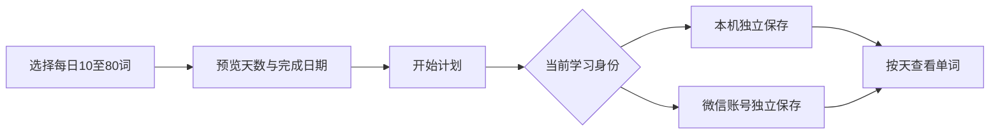
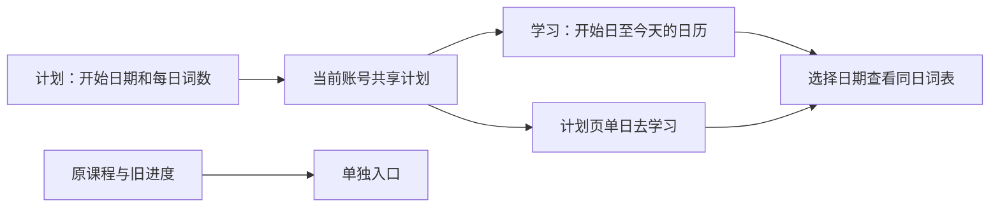
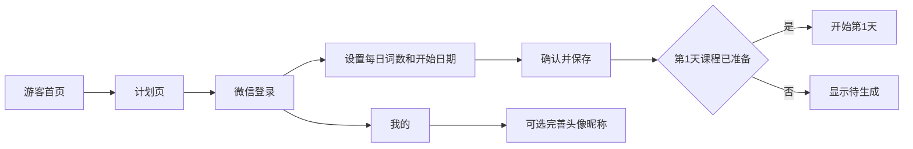

# 小程序首版拆解

| files | action | verify | done |
|---|---|---|---|
| src/shared、src/content | 复用真实两日课程、计划与校验 | 同源比较、内容校验 | 已实现 |
| config、src/pages、src/services | Taro独立页面及本机记录 | 类型、微信构建 | 已完成 |
| server | 微信身份、自定义会话、隔离保存 | 接口与安全测试 | 已完成 |
| audio、scripts/audio-manifest.mjs | 固定MP3地址及明确缺失 | SHA256、严格门禁 | 已完成，385条齐全 |
| docs、根文档 | 接口、部署、外部清单与归档 | 交叉复查 | 已完成 |

用户已明确授权直接开发；不新建分支或worktree，不修改网站，不操作真实数据库和微信后台。

## 补充音频（2026-10-20）

| files | action | verify | done |
|---|---|---|---|
| audio/en-GB/v1 | 生成361词＋24段固定英式MP3 | 全量解码、声音数据、帧长度 | 已完成 |
| scripts/generate-audio、verify-audio | 可追溯生成和严格构建门禁 | 文件SHA256及报告覆盖 | 已实现 |
| tests/audio.test.ts | 真实音频HTTP及文件匹配 | 类型/测试/构建 | 已通过 |
| 根文档及docs | 更新完成状态和本机播放条件 | Review后归档 | 已完成 |

## 四个底部菜单（2026-10-21）

| files | action | verify | done |
|---|---|---|---|
| app.config、assets、pages/home | 原生四菜单及首页真实概况 | 生成路由/图标核对 | 已通过 |
| pages/index | 原页面保留在学习，读取共享账号 | 原阅读/测验/收藏无回退 | 已实现 |
| pages/plan、pages/profile | 已发布计划及集中登录 | 进度、登录、退出入口 | 已实现 |
| services/session、shared/session-controller | 跨页账号、记录、学习日及会话恢复 | 隔离、失败原子性、过期、退出 | 已实现 |
| docs、根记录 | 页面职责和登录持久化说明 | 复查及归档 | 已完成 |

## 2026-10-21账号资料与每日词数
- [x] 主动选择微信头像、昵称审核及私有保存同步
- [x] 账号隔离Review、原学习记录保护、33项检查与构建
- [x] 计划设置：用户确认先完成10～80词选择与日程，短文测验生成待接入AI服务另行实施

## 开始前设置每日10～80词

| files | action | verify | done |
|---|---|---|---|
| shared/personal-plan | 校验10～80整数，按固定词序精确分天 | 全范围覆盖、不重不漏及尾批检查 | 已完成 |
| server/personal-plan、services | 独立保存本机/账号计划，不改原记录 | 隔离、重启、幂等及损坏保护 | 已完成 |
| pages/plan、home、profile、session | 预览后开始，跨页显示及账号恢复 | 类型、构建、会话测试、Review | 已完成 |
| 文档与归档 | 记录已设置与尚未生成课程的区别 | 交叉核对 | 已完成 |

用户确认先完成计划设置，无AI服务，自动生成短文测验暂不实施。

## 2026-11-18首页每日全新内容

| files | action | verify | done |
|---|---|---|---|
| shared、cloudfunctions/daily-content | hy4生成严格中英内容，腾讯云TTS生成MP3，完整后发布 | 格式、重复、音频头、幂等 | 已完成 |
| cloudfunctions/study、services | 匿名只读当天内容及固定音频 | 不接受任意fileID，不影响登录 | 已完成 |
| pages/home | 加载云端当天内容及明确失败重试 | 英文、译文、音频同源 | 已完成 |
| cloudbaserc、build scripts | 独立函数、凌晨3点触发及部署产物 | 双函数打包、触发配置 | 本地完成，待云端部署 |
| tests、docs、dist | 回归、Review、构建与记录 | 测试、类型、云包、微信构建 | 已完成 |

## 2026-11-17未登录三天试学

| files | action | verify | done |
|---|---|---|---|
| pages/index、app.css | 增加一次性三天试学开屏和试学日选择 | 未登录首次显示；确认后不重复阻挡 | 已完成 |
| session-controller | 本机试学不受旧个人计划约束 | 只开放真实三课；微信计划保持原规则 | 已完成 |
| tests、README、ARCHITECTURE、CONTEXT | 回归、Review、归档 | 测试、类型、内容、音频、构建 | 已完成 |

## 2026-11-17登录自动用户ID

| files | action | verify | done |
|---|---|---|---|
| shared/profile、cloud service、server profile | 服务端生成稳定只读用户ID，兼容旧资料 | 同账号固定、跨账号不同、OpenID不外泄 | 已完成 |
| AccountSheet、profile page | 显示用户ID，保留昵称和头像选择/上传 | 用户ID不可编辑；资料入口不回退 | 已完成 |
| tests、文档、归档 | 全量回归与第一性原理检查 | 测试、类型、云包、微信构建 | 已完成 |

## 2026-10-22统一学习与计划日历

| files | action | verify | done |
|---|---|---|---|
| shared/personal-plan、server/services | 支持过去开始日期及计划更新 | 日期、隔离、并发、旧记录不变 | 已完成 |
| session-controller、PersonalLearning、pages | 学习按计划日期范围显示、同日跳转，旧课单列 | 15日至22日、外部变更、入口Review | 已完成 |
| 文档归档 | 记录同源数据和学习内容尚未生成 | 类型/测试/构建、第一性原理复查 | 已完成 |

2026-10-22撤回：上一节“学习与计划日历统一”的学习页改造已按用户要求撤回，相关流程图作废；学习保持原有逻辑，仅保留独立计划设置。

## 仅同步原学习日历的日期范围

| files | action | verify | done |
|---|---|---|---|
| shared/learning-calendar、session-controller | 日历元数据按计划已到天数计算，实际课程列表保留 | 10天仅2课程、重启及计划切换 | 已完成 |
| pages/index | 原日历读新日期范围，缺课时仍可切换日期 | 不改阅读/测验/收藏历史渲染 | 已完成 |
| 文档归档 | 记录日历范围与实际内容的区别 | Review与第一性原理复查 | 已完成 |

Review修复：第10天切换到无计划账号时，计划键有→无也重置第1天，避免阻塞登录。第一性原理：开放日历范围不等于制造新课程，只改变日期可选元数据。

## 2026-10-22修复课程未生成误报

| files | action | verify | done |
|---|---|---|---|
| shared/plan-course-status、study目录、server/index | 真实目标词目录和严格匹配 | 2天有2课、10天仅2课、错词/错序/错编号 | 已完成 |
| pages/plan、home | 实际就绪数量与原课程入口，移除静态提示 | 模拟器当前2天已就绪、第二天原短文测验可打开 | 已完成 |
| 文档归档 | 当前无缺课，不接付费接口、不虚构新课 | Review及第一性原理复查 | 已完成 |

## 2026-10-23项目检查完成
已修复计划课程匹配、原课程复习、缺课记录入口、跨天刷新、重试重复记录、服务端退出撤销、音频越界、损坏存储错误及启动配置加载；补第3天真实课程与182条音频，总567条。Review及第一性原理复查完成，65通过0失败，类型与构建通过。依赖剩余同一braces上游未修复问题。详见 miniapp/docs/project-review-2026-10-23.md。

## 2026-10-23全词库随机课程
用户已确认从全部词库随机抽词并同步重做短文和测验。移除第1天旧词表保留逻辑，使用固定版本种子的Fisher–Yates全量洗牌，4952词不重不漏；同版本重启不重抽。正在重写前三天课程并制作新增音频。旧课程独立归档，收藏可只读回看，旧事件不计新课程进度，不修改用户数据。

### 随机课程完成
4952词从第1天全量固定版本洗牌；前三天30词课程全部重写，新561条MP3已生成，总1128条缺失0。旧课程只读归档，收藏可回看，原历史保留且不计新课进度。Review/第一性原理与交叉审校完成，72通过0失败、课程3通过、音频1128真实解码通过、类型与微信构建通过；主包1714224字节。同步工具已验证不覆盖新内容。详见miniapp/docs/random-plan-2026-10-23.md。

## 2026-11-06微信云开发迁移
用户确认采用微信云开发+托管文档数据库+云存储，不买自建服务器。正在准备TypeScript云函数、客户端云调用、打包及手动部署指引；保留学习界面与原HTTP后端，默认云模式但不自动兜底。尚未提供环境ID；不开通付费、不创建线上集合、不部署、不迁移原数据。云环境应选传统文档数据库模式非PG，Node20.19及以上适配sharp。三个代理并行后端/客户端/部署文档，主代理整合Review。skill：无。

## 2026-11-06微信云开发本地改造完成
默认cloud，保留显式HTTP开发；TypeScript study云函数接入托管文档集合/私有头像云存储，客户端云调用、事件分页、音频云SDK下载和头像沙盒缓存已完成。四菜单/学习页保留，旧HTTP记录和原会话不自动迁移；新会话按环境隔离，不自动兜底HTTP。Review及第一性原理复查完成，交叉检查发现普通头像下载域名限制，已改无普通HTTP下载的云链路。94通过0失败、类型/微信构建/云包打包通过；1128音频完整性通过。尚无环境ID，未开通付费、未建集合、未上传/部署、未改真实学习数据，真机/云端验证待用户本人操作。参见miniapp/docs/cloud-development.md。skill：无。

## 2026-11-17登录与开始计划流程

| files | action | verify | done |
|---|---|---|---|
| components/AccountSheet、pages/profile | 登录与头像昵称拆开，登录成功明确反馈 | 登录成功不进入资料编辑；资料仍可独立保存 | 已完成 |
| pages/plan | 未登录拦截并原页登录；历史日期与修改计划确认 | 游客不能创建本机计划；登录后停留在计划页 | 已完成 |
| pages/plan、shared/plan-course-status | 每日显示真实课程状态，首日课程可直接开始 | 已发布/待生成/状态错误不混淆 | 已完成 |
| tests、README、ARCHITECTURE、CONTEXT | 回归、Review、第一性原理检查及归档 | 测试、类型、内容、音频、构建、模拟器 | 已完成 |

